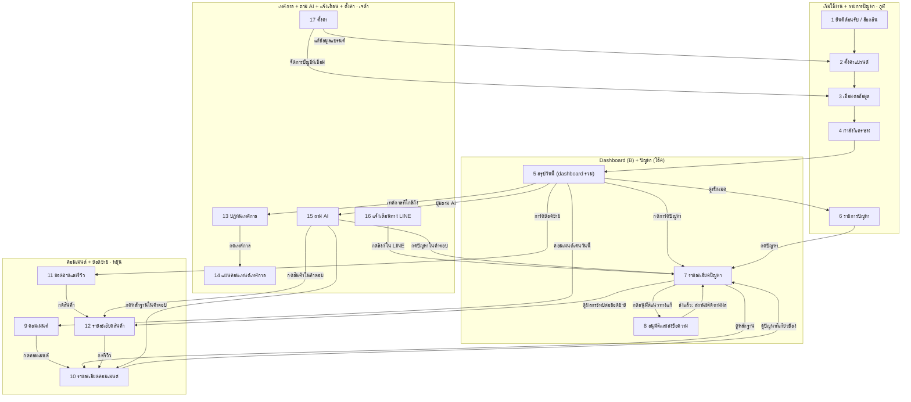

# BrandCare AI: รายการหน้า Mockup และ Flow

เอกสารนี้ใช้แบ่งงานทำ mockup ให้ทีม 4 คน แต่ละหน้าบอกไว้ว่า **มาจากหน้าไหน**, **ไปต่อหน้าไหน**, **ต้องมีอะไรบ้าง** และ **ใครรับผิดชอบ**

---

## 1. ข้อตกลงร่วมกัน (ทุกคนอ่านก่อนเริ่ม)

### โปรเจกต์ (ล็อกแล้ว)
| หัวข้อ | ใช้ตามนี้ |
|---|---|
| ชื่อสินค้า | **BrandCare AI** |
| ประโยคเดียว | AI ดูแลร้านแทนเจ้าของ อ่านเสียงลูกค้าทุกช่องทาง เชื่อมกับยอดขาย บอกว่าวันนี้ต้องทำอะไร และลงมือทำให้หลังได้รับอนุมัติ |
| แนวทางในใบสมัคร | **AI-Native Products & Operations** (หลัก) + **Autonomous & Adaptive AI** |
| ร้าน demo | **ขนมบ้านสวน** ร้านขนมไทยของครอบครัว (รายละเอียดทั้งหมดอยู่ใน **ข้อ 6**) |

### กติกาเรื่องเนื้อหา
- **ใช้ข้อมูลร้าน demo ในข้อ 6 ชุดเดียว** ห้ามแต่งตัวเลขเพิ่มเอง ถ้าต้องการข้อมูลที่ไม่มี ให้เพิ่มลงข้อ 6 ก่อนแล้วบอกทีม กรรมการจะดูออกถ้าตัวเลขไม่ตรงกันข้ามหน้า
- **วันที่ในหน้าจอ:** พฤหัสบดี 22 ตุลาคม 2026
- **ดีไซน์อ้างอิง Dashboard ปัจจุบันของทีมที่ `D:\token-free`**: ฟอนต์ SF Pro TH / SF Pro, พื้นขาวเทา `#f5f5f7`, การ์ดมุมโค้ง 24–26px, ปุ่มสีน้ำเงิน `#0071e3` และ Header โปร่งเบลอแบบสองชั้น แต่ข้อความในหน้าจอต้องเป็นภาษาไทยทั้งหมด ห้ามมีคำอย่าง "Total Revenue" ค้างอยู่
- **ขนาด frame:** Desktop 1440 × 900 ทุกหน้า และ Mobile 390 × 844 เฉพาะหน้า 5 และ 16

### ป้ายประเภทคอมเมนต์ (ใช้สีและไอคอนเดียวกันทุกหน้า)
| ป้าย | ความหมาย | โทนสี |
|---|---|---|
| 🔥 ต้องตอบด่วน | ลูกค้าเจอปัญหาและรอคำตอบ | แดง |
| ⚠️ เสี่ยงดราม่า | ยอดไลก์หรือแชร์ขึ้นเร็วผิดปกติ | แดงเข้ม |
| 💡 ไอเดียสินค้า | ลูกค้าเสนอหรือขอสินค้าใหม่ | น้ำเงิน |
| ⭐ คำชม | นำไปใช้ทำคอนเทนต์ได้ | เหลือง |
| 🎯 อยากซื้อ | ถามราคาหรือถามว่าซื้อที่ไหน | เขียว |
| 🕵️ พูดถึงคู่แข่ง | เอ่ยชื่อหรือเปรียบเทียบกับร้านอื่น | ชมพู |

### ส่วนที่ทุกหน้าใช้ร่วมกัน (B ทำให้เสร็จก่อน แล้วทุกคนใช้ชุดเดียวกัน)
- **Header ชั้นบน:** โลโก้ BrandCare AI · โลโก้ขนมบ้านสวนวางข้างชื่อร้าน · ช่องค้นหาทั้งร้าน (ปุ่มลัด Ctrl/Cmd + K) · ไอคอนแจ้งเตือน · โปรไฟล์ร้าน
- **Header ชั้นล่างแบบ sticky:** ชื่อร้าน · เมนูแนวนอน สรุปวันนี้ / ปัญหา / คอมเมนต์ / ยอดขายและรีวิว / เทศกาล / ถาม AI / ตั้งค่า · ปุ่มหลัก "ถาม AI"
- **ไม่ใช้ Sidebar** ตามความต้องการของผู้ใช้ บนมือถือซ่อน Header ชั้นล่าง ใช้ **Bottom nav 4 เมนูหลัก** (วันนี้ / ปัญหา / คอมเมนต์ / ถาม AI) และ **ปุ่มเมนูตรงกลาง** เปิดกล่องฟองอากาศลอยเหนือปุ่มกลางสำหรับ ยอดขายและรีวิว / เทศกาล / ตั้งค่า ไม่อัดทุกเมนูลงในแถบเดียว
- **Bottom nav แบบ Apple:** แถบลอยกระจกขาว มุมมน แสดงชื่อเฉพาะเมนูที่เลือกบนแคปซูลสีดำ เมนูอื่นเป็นปุ่มวงกลม คงปุ่มกลางเปิดเมนูเพิ่มเติมแบบกล่องฟองอากาศลอยเหนือ Navbar โดยไม่เบลอทั้งหน้า
- **Header ร่วม:** ใช้ shell เดียวกันทุกหน้าและทุกคน ห้ามเขียน Header แยกเอง · ปุ่ม "ถาม AI" เปิดหน้า 15 จากทุกหน้า
- **คอมโพเนนต์:** การ์ด / การ์ดตัวเลข / การ์ดปัญหา / การ์ดคอมเมนต์ · ป้ายประเภท 6 แบบ · ไอคอนแพลตฟอร์มย่อ · แถวรายการ · ปุ่มหลัก/รอง/ปิดใช้งาน · ตัวกรอง · ช่องกรอกข้อมูล · เส้นแนวโน้ม · หน้าต่าง/แผงเลื่อน · toast · สถานะโหลด/ว่าง/ผิดพลาด
- **ภาษาใน UI:** ใช้หัวข้อที่บอกข้อมูล/งานจริง เช่น "กล่องบุบ 23 คอมเมนต์" ตัดคำโปรยทั่วไปและคำโฆษณาที่ไม่ช่วยตัดสินใจ
- **การเคลื่อนไหว:** กล่องเมนูฟองอากาศขยายขึ้นจากปุ่มกลาง ·  เมนู pill เลื่อนนุ่มนวล · การ์ดเผยเมื่อเลื่อน · ตัวเลขไล่ขึ้น · เส้นกราฟวาดเข้า · modal/drawer เข้าอย่างนุ่มนวล · รองรับ `prefers-reduced-motion`
- **Git workflow สำหรับ AI ของทีม:** อ่าน `TEAM-GIT-WORKFLOW.md` ให้ AI ตรวจ/ติดตั้ง GitHub CLI สร้าง branch แยก push และ rebase กับ `origin/main` ล่าสุดก่อน merge ผ่าน PR
- **ไฟล์กลาง:** `shared/tokens.css`, `shared/components.css`, `shared/brandcare.css`, `shared/ui.js`, `shared/data.js` ที่ `D:\token-free` · ตัวอย่างที่ `http://localhost:4174/#/components`
- **ข้อมูล:** ทุกคน import จาก `shared/data.js` ซึ่งอ้างอิงข้อ 6 ไม่คัดลอกตัวเลขหรือสร้างข้อมูลรายวันเพิ่มเอง

### ขอบเขตรอบปัจจุบัน (ผู้ใช้คือ B)
- ทำให้เสร็จเฉพาะ **ไฟล์กลางและหน้า 5 Dashboard รวม** ก่อน
- เนื้อหาทั้งหมดเป็น BrandCare AI / ขนมบ้านสวน ใช้เพียงสไตล์ของ Dashboard เดิม ไม่ใช้เนื้อหา สินค้า หรือรูป iPhone
- หน้า 1–4 และ 6–17 เป็นงานรอบถัดไป ไม่ถือว่าเสร็จในรอบนี้
- ปุ่มไปหน้าอื่นเชื่อม route ตาม Flow แต่แสดงจุดเชื่อมต่อพร้อมป้าย "หน้านี้จะทำในรอบถัดไป" ยังไม่มี business flow ของหน้านั้น
- ยังไม่เชื่อม API, OAuth, AI จริง หรือส่งข้อความ/โพสต์จริง และรันเฉพาะ Localhost ตามคำขอผู้ใช้
- ชื่อเจ้าของงานเดิมด้านล่างยังใช้แบ่งงานรอบถัดไปได้ โดย B ส่งชุดกลางและหน้า 5 ให้ก่อน ไม่ถือว่า B เป็นบุคคลเดียวกับชื่อในแผนเดิม

---

## 2. แบ่งงาน

| คน | ส่วนที่รับผิดชอบ | หน้า |
|---|---|---|
| **B (ผู้ใช้ · รอบนี้)** | ชุดไฟล์กลาง + Dashboard รวมตามธีมปัจจุบัน | ส่วนที่ใช้ร่วมกัน, 5 |
| **ภูมิ** | เริ่มใช้งาน + รายการปัญหา โดยใช้ชุดกลางจาก B | 1, 2, 3, 4, 6 · รอบถัดไป |
| **โอ๊ค** | ปัญหา (แกนหลักของ demo) + ประสานงานทีม ใช้หน้า 5 และชุดกลางจาก B | 7, 8 · รอบถัดไป |
| **หยุ่น** | คอมเมนต์ + ยอดขาย | 9, 10, 11, 12 |
| **เจด้า** | เทศกาล + ถาม AI + แจ้งเตือน + ตั้งค่า | 13, 14, 15, 16, 17 |

> **ลำดับ:** B ส่ง Header สองชั้น, design tokens, ข้อมูลกลาง และคอมโพเนนต์ให้ทีมก่อนเริ่มหน้ารอบถัดไป ระหว่างรอ คนอื่นร่างโครงหน้าของตัวเองแบบขาวดำไปก่อน
>
> **B ภูมิ และโอ๊คใช้สัญญาคอมโพเนนต์เดียวกัน:** หน้า 6 (ภูมิ) ใช้ `issueCard()` เดียวกับส่วนปัญหาหน้า 5 (B) และหน้า 7 (โอ๊ค) ให้ตกลงหน้าตาการ์ดปัญหาร่วมกันตั้งแต่แรก
>
> **โอ๊คเป็นคนตรวจงานทุกหน้า** ว่าตัวเลขตรงกับข้อ 6 และปุ่มทุกอันพาไปหน้าตาม Flow

---

## 3. Flow ภาพรวม



**เมนูแนวนอนใน Header** พาไปหน้า 5, 6, 9, 11, 13, 15 และ 17 ได้จากทุกหน้า ส่วน **ปุ่ม "ถาม AI" ใน Header ชั้นล่าง** เปิดหน้า 15 ได้จากทุกหน้า (ไม่ได้วาดเส้นทั้งหมดในแผนภาพ เพราะจะรกเกินไป)

> ถ้าเปิดไฟล์นี้แล้วแผนภาพไม่แสดง ให้คัดลอกโค้ดในกล่องไปวางที่ https://mermaid.live หรือเปิดบน GitHub, Notion หรือ VS Code

### เส้นทางที่ใช้ในวิดีโอ demo (ทุกหน้าในเส้นทางนี้ต้องสวยที่สุด)
```
1 → 2 → 3 → 4 → 5 สรุปวันนี้
            → 7 รายละเอียดปัญหา "กล่องบุบ"
            → 10 ดูหลักฐานคอมเมนต์ (รวมคลิป TikTok)
            → 12 ดูผลกระทบยอดขายทองม้วน
            → 8 อนุมัติและส่งข้อความ → 7 (สถานะ: ติดตามผล)
            → 15 ถาม AI "ทำไมยอดขายสัปดาห์นี้ลดลง"
            → 16 ปิดท้ายด้วยแจ้งเตือนบนมือถือ
```

---

## 4. รายละเอียดแต่ละหน้า

### หน้า 1 · ยินดีต้อนรับ / ล็อกอิน (ภูมิ)
- **มาจาก:** – (หน้าแรกสุด)
- **ไปต่อ:** หน้า 2
- **ต้องมี:**
  - โลโก้ ชื่อ BrandCare AI และคำโปรยหนึ่งประโยค เช่น "AI ดูแลร้านแทนคุณ บอกว่าวันนี้ต้องทำอะไร"
  - ปุ่ม "เข้าสู่ระบบด้วย Google" และ "เข้าสู่ระบบด้วยอีเมล"
  - ภาพตัวอย่างหน้าสรุปวันนี้แบบย่อ ให้เห็นภาพตั้งแต่หน้าแรก

### หน้า 2 · ตั้งค่าแบรนด์ (ภูมิ)
- **มาจาก:** หน้า 1 · หน้า 17 (แก้ข้อมูลแบรนด์)
- **ไปต่อ:** หน้า 3
- **ต้องมี:**
  - แถบบอกขั้นตอน "1 ข้อมูลแบรนด์ · 2 เชื่อมต่อข้อมูล · 3 วิเคราะห์"
  - ชื่อร้าน · ประเภทสินค้า · รายการสินค้า (เพิ่มเป็นชิป)
  - กลุ่มลูกค้าหลัก · คู่แข่ง (ใส่ชื่อหรือลิงก์เพจ)
  - น้ำเสียงของแบรนด์ (เลือก: เป็นกันเอง / สุภาพ / สนุก) พร้อมตัวอย่างข้อความ
  - คีย์เวิร์ดที่ต้องติดตาม เช่น ชื่อร้าน ชื่อสินค้า แฮชแท็ก

### หน้า 3 · เชื่อมต่อข้อมูล (ภูมิ)
- **มาจาก:** หน้า 2 · หน้า 17 (จัดการบัญชีที่เชื่อม)
- **ไปต่อ:** หน้า 4
- **ต้องมี:**
  - การ์ดแต่ละแพลตฟอร์ม (Facebook Page, Instagram, YouTube, Shopee, TikTok Shop) พร้อมปุ่ม "เชื่อมต่อ" และสถานะ "เชื่อมแล้ว ✓"
  - บอกว่าแต่ละแพลตฟอร์มจะดึงอะไร เช่น "คอมเมนต์ในเพจของคุณ" หรือ "ออเดอร์และรีวิว"
  - ทางเลือก "อัปโหลดไฟล์ CSV" สำหรับแพลตฟอร์มที่ยังเชื่อมไม่ได้
  - ข้อความเรื่องความเป็นส่วนตัว: "เราอ่านเฉพาะข้อมูลของร้านคุณ และไม่โพสต์อะไรโดยไม่ได้รับอนุมัติ"

### หน้า 4 · กำลังวิเคราะห์ (ภูมิ)
- **มาจาก:** หน้า 3
- **ไปต่อ:** หน้า 5 (ไปเองอัตโนมัติเมื่อเสร็จ)
- **ต้องมี:**
  - ขั้นตอนที่ขึ้นทีละบรรทัด: "ดึงคอมเมนต์ 1,284 รายการ ✓ → อ่านรีวิว 312 รายการ ✓ → จับคู่กับยอดขาย ✓ → พบ 3 เรื่องที่ควรทำ"
  - ตัวเลขที่เพิ่มขึ้นเรื่อย ๆ ให้รู้สึกว่า AI กำลังทำงานอยู่จริง

### หน้า 5 · สรุปวันนี้ (B ทำรอบปัจจุบัน) · หน้าหลัก
- **มาจาก:** หน้า 4 · เมนูแนวนอนใน Header
- **ไปต่อ:** หน้า 6, 7, 9, 11, 13, 15
- **ต้องมี:**
  - หัวข้อใหญ่ "สรุปวันนี้" และวันที่
  - **การ์ด 3 ใบเรียงแนวนอน:** ปัญหา (23 คอมเมนต์ · กล่องบุบ +340%) · ยอดขาย (฿48,200 พร้อมกราฟเส้นเล็ก) · คะแนนรีวิว (4.5 ลดลงจาก 4.8)
  - **"ควรทำวันนี้":** รายการ 3 ข้อตามข้อ 6.9 แต่ละข้อมีปุ่ม "อนุมัติ" หรือ "ดู"
  - **คอมเมนต์เด่นวันนี้:** 3 อัน พร้อมป้ายประเภท และลิงก์ "ดูทั้งหมด" ไปหน้า 9
  - **เทศกาลที่ใกล้ถึง:** "11.11 · อีก 20 วัน" ไปหน้า 13
  - **Mobile 390px:** ทำหน้านี้เวอร์ชันมือถือด้วย

### หน้า 6 · รายการปัญหา (ภูมิ)
- **มาจาก:** หน้า 5 (ดูทั้งหมด) · เมนูแนวนอนใน Header
- **ไปต่อ:** หน้า 7
- **ต้องมี:**
  - แท็บสถานะ: ใหม่ · กำลังแก้ · ติดตามผล · แก้แล้ว
  - การ์ดปัญหาแต่ละใบ: ชื่อปัญหา · ระดับความรุนแรง · จำนวนคอมเมนต์ · แพลตฟอร์ม · กราฟเส้นเล็ก · วันที่เริ่มเกิด
  - ปัญหาตัวอย่างอย่างน้อย 4 เรื่อง: กล่องบุบ (รุนแรง) · ส่งช้า (ปานกลาง) · หวานเกินไป (ต่ำ) · ลูกค้าขอรสทุเรียน (โอกาส)

### หน้า 7 · รายละเอียดปัญหา (โอ๊ค) · หน้าที่สำคัญที่สุดใน demo
- **มาจาก:** หน้า 5 · 6 · 10 · 15 · 16 · หน้า 8 (กลับมาหลังส่ง)
- **ไปต่อ:** หน้า 8, 10, 12
- **ต้องมี:**
  - หัวข้อ "ลูกค้าบ่นเรื่องกล่องบุบ +340%" · ป้ายรุนแรง · สถานะ
  - **สาเหตุที่ AI วิเคราะห์:** "เริ่มหลังเปลี่ยนเจ้าขนส่ง 14 ต.ค."
  - **หลักฐาน:** คอมเมนต์ตัวอย่าง 3–5 อัน + การ์ดคลิป TikTok ที่ถอดเสียงไว้ ("กล่องยับมาก ข้างในแตกเป็นผง") + ลิงก์ "ดูทั้งหมด 23 อัน" ไปหน้า 10
  - **ผลกระทบ:** กราฟคู่ระหว่างจำนวนคำบ่นกับยอดขายทองม้วน · ยอด −32% · คะแนน 4.8 เป็น 4.5 · ลิงก์ไปหน้า 12
  - **แนวทางแก้ 3 ทาง** แต่ละทางบอกต้นทุนและผลที่คาดไว้ เช่น 1) เปลี่ยนเป็นกล่องที่หนาขึ้น (+฿3 ต่อชิ้น) 2) ตอบลูกค้า 23 คนพร้อมคูปอง 3) โพสต์คลิปแพ็กของแบบใหม่
  - ปุ่ม "อนุมัติแนวทางแก้" ไปหน้า 8
  - **สถานะหลังอนุมัติ (ทำ frame แยก):** แถบ "ติดตามผล · จะเช็กผลอีกครั้ง 29 ต.ค."

### หน้า 8 · อนุมัติและส่งข้อความ (โอ๊ค) · แผ่นซ้อนบนหน้า 7
- **มาจาก:** หน้า 7
- **ไปต่อ:** หน้า 7 (สถานะติดตามผล)
- **ต้องมี:**
  - รายการลูกค้า 23 คนพร้อมแพลตฟอร์มของแต่ละคน
  - ร่างข้อความตอบที่ AI เขียนตามน้ำเสียงของแบรนด์ แก้ไขได้
  - ร่างโพสต์ประกาศเรื่องกล่องใหม่ พร้อมภาพตัวอย่างที่จะโพสต์
  - ติ๊กเลือกได้ว่าจะส่งอะไรบ้าง · ปุ่ม "ส่งทั้งหมด" และ "ยกเลิก"
  - ข้อความยืนยันหลังส่ง (toast): "ส่งแล้ว 23 ข้อความ"

### หน้า 9 · คอมเมนต์ (หยุ่น)
- **มาจาก:** หน้า 5 · เมนูแนวนอนใน Header
- **ไปต่อ:** หน้า 10
- **ต้องมี:**
  - ชิปตัวกรองประเภท (6 ป้าย) พร้อมจำนวนในแต่ละประเภท
  - ตัวกรองแพลตฟอร์ม สินค้า และช่วงเวลา · เรียงตาม "สำคัญที่สุด" หรือ "ใหม่ที่สุด"
  - รายการคอมเมนต์: ไอคอนแพลตฟอร์ม · ชื่อผู้ใช้ (ปิดบังบางส่วน เช่น "ปุ๊ก***") · ข้อความ · ป้ายประเภท · ยอดไลก์ · เวลา · หัวข้อที่ AI แยกไว้ (เช่น แพ็กเกจ)
  - ข้อมูลตัวอย่างอย่างน้อย 12 คอมเมนต์ ให้ครบทุกประเภท

### หน้า 10 · รายละเอียดคอมเมนต์ (หยุ่น) · แผงที่เลื่อนออกมาจากด้านขวา
- **มาจาก:** หน้า 7 · 9 · 12 · 15
- **ไปต่อ:** หน้า 7 (ปัญหาที่เกี่ยวข้อง) · ลิงก์ไปโพสต์ต้นทาง
- **ต้องมี:**
  - ข้อความเต็ม · โพสต์ต้นทาง (ภาพย่อ + ปุ่ม "เปิดใน Facebook")
  - **ถ้าเป็นคลิป:** ภาพย่อคลิป · ข้อความที่ถอดเสียงไว้ โดยเน้นประโยคสำคัญ · จำนวนผู้ชม
  - สิ่งที่ AI วิเคราะห์: ประเภท · หัวข้อ · ความรู้สึก · เหตุผลที่จัดเป็นประเภทนี้
  - ร่างคำตอบพร้อมปุ่ม "ส่ง" และ "แก้ไข"
  - การ์ด "ปัญหาที่เกี่ยวข้อง" ไปหน้า 7

### หน้า 11 · ยอดขายและรีวิว (หยุ่น)
- **มาจาก:** หน้า 5 · เมนูแนวนอนใน Header
- **ไปต่อ:** หน้า 15 (ถาม AI จากสินค้า) · หน้า 12 (รายละเอียดสินค้า เป็นทางรอง)
- **ต้องมี:**
  - เลือกช่วงเวลา (7 วัน / 30 วัน / 90 วัน) และช่องทาง (ทั้งหมด / Shopee / TikTok Shop / LINE OA); ตัวกรองมีผลกับทั้งหน้าและแสดงค่าที่เลือกอยู่
  - ตัวเลขสรุป: ยอดขายสุทธิหลังหักยกเลิก/คืนเงิน · ออเดอร์ที่ชำระแล้ว · คะแนนรีวิวเฉลี่ยตัวอย่างจาก Shopee และ TikTok Shop
  - ยอดขายแยก Shopee / TikTok Shop / LINE OA ใช้สัดส่วนตัวอย่าง 60/30/10 พร้อมป้ายข้อมูลตัวอย่าง
  - **กราฟเชื่อมยอดขายกับเสียงลูกค้า:** เส้นยอดขายกับแท่งจำนวนคำบ่น ใช้หน่วยแยกกัน และมี marker วันที่ 14 ต.ค. “เปลี่ยนเจ้าขนส่ง”; สื่อว่าเริ่มพบคำบ่นเพิ่มหลังการเปลี่ยนขนส่งตามช่วงเวลา ไม่ยืนยันเหตุและผล
  - ตารางสินค้า: ชื่อ · ยอดขาย · เปลี่ยนแปลง % · คะแนนรีวิว · หัวข้อที่พูดถึงมากที่สุด · ปุ่มถาม AI พร้อมชื่อสินค้าและตัวกรองเดิม
  - รีวิว marketplace ตัวอย่าง 3–5 รายการ; เมื่อเลือก LINE OA ให้บอกว่าไม่มีคะแนน marketplace แทนการแสดงคะแนนซ้ำ
  - ประวัติที่สร้างเพิ่มและรีวิวทั้งหมดติดป้าย “ข้อมูลตัวอย่าง”; หน้า 15 ที่เปิดจากหน้านี้แสดงคำถามที่เติมชื่อสินค้าและระบุว่า AI ยังไม่เชื่อมต่อ

### หน้า 12 · รายละเอียดสินค้า (หยุ่น)
- **มาจาก:** หน้า 7 · 11 · 15
- **ไปต่อ:** หน้า 10 (กดรีวิว)
- **ต้องมี:**
  - รูปและชื่อสินค้า (ทองม้วนกรอบ) · ยอดขาย · คะแนน
  - กราฟยอดขาย 8 สัปดาห์ แยก Shopee และ TikTok Shop
  - **ลูกค้าพูดถึงอะไร:** แถบหัวข้อพร้อมสัดส่วนบวกและลบ (รสชาติ 92% บวก / แพ็กเกจ 71% ลบ)
  - รีวิวบวกเด่นและรีวิวลบเด่นอย่างละ 2 รีวิว
  - สิ่งที่ AI แนะนำสำหรับสินค้านี้

### หน้า 13 · ปฏิทินเทศกาล (เจด้า)
- **มาจาก:** หน้า 5 · เมนูแนวนอนใน Header
- **ไปต่อ:** หน้า 14
- **ต้องมี:**
  - ไทม์ไลน์ 90 วันข้างหน้า: 11.11 · ลอยกระทง · 12.12 · คริสต์มาส · ปีใหม่
  - การ์ดแต่ละเทศกาล: นับถอยหลัง · ผลของปีก่อน (เช่น "ชุดของขวัญขายดีขึ้น 3.4 เท่าช่วงปีใหม่") · สถานะแผน (ยังไม่มี / ร่างแล้ว / พร้อม)

> ⚠️ วันลอยกระทง 2569 ยังไม่ได้ยืนยันวันที่ ให้เช็กปฏิทินทางการก่อนใส่ หรือใส่แค่ "ปลาย พ.ย."

### หน้า 14 · แผนคอนเทนต์เทศกาล (เจด้า)
- **มาจาก:** หน้า 13 · หน้า 5 (ข้อ "เตรียมโปร 11.11")
- **ไปต่อ:** หน้า 13 (กลับ) · หน้า 8 (ถ้ากดอนุมัติโพสต์ ใช้แผ่นซ้อนแบบเดียวกัน)
- **ต้องมี:**
  - **ข้อมูลที่ AI ใช้วางแผน:** 11.11 ปีก่อนสินค้าไหนขายดี ลูกค้าบ่นอะไร และสต็อกตอนนี้เหลือเท่าไหร่
  - **คำแนะนำ:** "เตรียมสต็อกทองม้วนเพิ่ม 2 เท่า · บอกเวลาจัดส่งให้ชัด · ทำชุดของขวัญราคาพิเศษ"
  - **ปฏิทินโพสต์ 7 วันก่อนเทศกาล:** การ์ดโพสต์แต่ละวัน (ช่องทาง · ไอเดีย · แคปชันที่ร่างไว้)
  - ปุ่ม "อนุมัติแผน"

### หน้า 15 · ถาม AI (เจด้า)
- **มาจาก:** ปุ่ม "ถาม AI" ใน Header ชั้นล่าง (ทุกหน้า) · เมนูแนวนอนใน Header
- **ไปต่อ:** หน้า 7, 10, 12 (กดหลักฐานในคำตอบ)
- **ต้องมี:**
  - ปุ่มคำถามแนะนำ: "ทำไมยอดขายสัปดาห์นี้ลดลง" · "ลูกค้าบ่นเรื่องอะไรมากที่สุด" · "เทียบกับคู่แข่ง เราแพ้เรื่องอะไร" · "วางแผนโพสต์ 11.11 ให้หน่อย"
  - **แสดงขั้นตอนที่ AI ทำ:** "ดูยอดขาย ✓ → ค้นคอมเมนต์เรื่องปัญหา ✓ → เทียบช่วงเวลา ✓" ให้กรรมการเห็นว่า AI ค้นข้อมูลจริง
  - คำตอบที่มี **ชิปหลักฐาน** (เช่น "คอมเมนต์ #12", "ปัญหา: กล่องบุบ", "สินค้า: ทองม้วน") กดแล้วไปหน้าที่เกี่ยวข้อง
  - ช่องพิมพ์คำถามด้านล่าง
  - **ทำ frame ครบบทสนทนาสำหรับคำถาม "ทำไมยอดขายสัปดาห์นี้ลดลง"** เพราะใช้ในวิดีโอ

### หน้า 16 · แจ้งเตือนทาง LINE (เจด้า) · Mobile 390px
- **มาจาก:** – (ระบบส่งเอง เมื่อเจอเรื่องด่วนหรือถึงเวลาสรุปเช้า)
- **ไปต่อ:** หน้า 7
- **ต้องมี:**
  - หน้าจอแชท LINE ที่มีข้อความจาก BrandCare AI: "⚠️ คำบ่นเรื่องกล่องบุบเพิ่มขึ้น 340% · ยอดทองม้วน −32% · มี 3 เรื่องที่ควรทำวันนี้" พร้อมปุ่ม "ดูรายละเอียด"
  - frame ที่สอง: ข้อความสรุปทุกเช้า 08:00
  - ⚠️ ทำเป็นหน้าจอแชทแบบทั่วไป ห้ามใช้โลโก้ LINE หรือทำให้เหมือนแอป LINE ทุกจุด

### หน้า 17 · ตั้งค่า (เจด้า)
- **มาจาก:** เมนูแนวนอนใน Header
- **ไปต่อ:** หน้า 2 (แก้ข้อมูลแบรนด์) · หน้า 3 (จัดการบัญชีที่เชื่อม)
- **ต้องมี:**
  - รายการแบ่งกลุ่ม: แบรนด์ · บัญชีที่เชื่อม · การแจ้งเตือน · ทีม
  - **การแจ้งเตือน:** เปิด/ปิด LINE · เวลาสรุปเช้า · ระดับเรื่องที่ต้องแจ้งทันที
  - **ความเป็นอัตโนมัติ:** "ให้ AI ตอบคำชมเองได้โดยไม่ต้องอนุมัติ" (เปิด/ปิด) · "เรื่องร้องเรียนต้องให้คนอนุมัติเสมอ" (ล็อกไว้เปิด)

---

## 5. Checklist ก่อนส่ง mockup
- [ ] ตัวเลขตรงกับข้อ 6 ทุกหน้า (23 คอมเมนต์ · +340% · −32% · 4.8 เป็น 4.5 · ฿48,200 · อีก 20 วัน)
- [ ] ป้ายประเภทใช้สีและไอคอนเดียวกันทุกหน้า
- [ ] ทุกหน้าใช้ Header สองชั้นจาก `shell()` ใน `shared/ui.js` ไม่มี Sidebar และไม่ทำ Header ซ้ำเอง
- [ ] ปุ่มและลิงก์ทุกอันพาไปหน้าตาม Flow ในข้อ 3 (ถ้าทำ prototype ใน Figma ให้ต่อลิงก์ตามนี้)
- [ ] ไม่มีข้อความภาษาอังกฤษค้างอยู่ ยกเว้นชื่อแพลตฟอร์ม
- [ ] ไม่ใช้โลโก้หรือหน้าตาที่เลียนแบบ Shopee, TikTok หรือ LINE ให้ใช้แค่ไอคอนขนาดเล็กบอกแพลตฟอร์ม
- [ ] หน้าในเส้นทาง demo (1 → 5 → 7 → 10 → 12 → 8 → 15 → 16) เสร็จก่อนหน้าอื่น

---


### รายละเอียดการส่งต่องานรอบนี้
- [x] ชุดไฟล์กลางและ Header แนวนอนสองชั้นพร้อมส่งต่อ
- [x] หน้า 5 เปลี่ยนเป็น BrandCare AI / ขนมบ้านสวนครบตามขอบเขต ไม่มีเนื้อหา iPhone
- [x] ตรวจข้อมูลกลาง ป้าย 6 ประเภท แพลตฟอร์ม 5 ช่องทาง ลิงก์ CTA และฟอนต์ในเครื่อง
- [x] ทดสอบเบราว์เซอร์: ค้นหา แจ้งเตือน modal/drawer/toast และสถานะว่าง · Desktop 1440 × 900 / Mobile 390 × 844 ไม่ล้นแนวนอน
- [ ] หน้าอื่นรอบถัดไป (ยังไม่ได้พัฒนา)

- Dashboard รวม: `http://localhost:4174/#/today` · ใช้ข้อมูลข้อ 6 ได้แก่ 23 คอมเมนต์, +340%, ฿48,200, −18%, คะแนน 4.8 → 4.5, งานวันนี้ 3 ข้อ และ 11.11 อีก 20 วัน
- คอมเมนต์เด่นใช้รายการ #1, #5 และ #7 จากข้อ 6.7 ครบทั้งปัญหา ความต้องการซื้อ และคำชม
- ปุ่ม "อนุมัติ" ในงานเปลี่ยนกล่องเปิดจุดเชื่อมต่อหน้า 7 เพื่อให้ดูสาเหตุก่อนอนุมัติในหน้า 8; งานตอบลูกค้า 23 คนเปิดจุดเชื่อมต่อหน้า 8; งานตอบคนถามซื้อเปิดหน้า 9 พร้อมตัวกรอง `intent`
- กราฟกลางหน้า 5 เปรียบเทียบยอดขายรวมและยอดทองม้วนเฉพาะ 2 สัปดาห์ที่มีตัวเลขในข้อ 6.5 ไม่สร้างยอดรายวันขึ้นเอง
- เส้น sparkline บนการ์ดเป็นภาพแนวโน้มประกอบการสาธิตเท่านั้น ไม่ใช่ชุดข้อมูลยอดขาย/คอมเมนต์รายวัน
- คู่มือใช้งานไฟล์กลาง: `D:\token-free\shared\README.md` และหน้า `#/components`
- หน้าอื่นยังเป็นจุดเชื่อมต่อ ไม่ติ๊ก checklist ว่าเสร็จทั้ง 17 หน้า

## 6. ข้อมูลร้าน demo: ขนมบ้านสวน

> "ขนมบ้านสวน" เป็นชื่อสมมติ ก่อนใช้จริงให้ค้นใน Shopee และ Facebook ก่อนว่าไม่ซ้ำกับร้านที่มีอยู่จริง ถ้าซ้ำให้เปลี่ยนชื่อในข้อนี้ที่เดียว

### 6.1 ข้อมูลร้าน
| หัวข้อ | ข้อมูล |
|---|---|
| ชื่อร้าน | ขนมบ้านสวน |
| ที่ตั้ง | อ.สามพราน จ.นครปฐม |
| เริ่มขายออนไลน์ | 2022 |
| เจ้าของ | **คุณแพร** อายุ 34 ปี ทำร้านกับแม่ซึ่งเป็นคนทำขนม |
| ทีม | 4 คน: คุณแพร (ขาย ตอบแชท ทำการตลาด) · แม่ (ทำขนม) · พนักงานแพ็กของ 2 คน |
| ปัญหาของเจ้าของ | วันหนึ่งมีคอมเมนต์และแชทหลายร้อยข้อความ อ่านไม่ทัน ไม่รู้ว่ายอดขายลดเพราะอะไร ไม่มีเงินจ้างทีมการตลาด |
| น้ำเสียงของแบรนด์ | เป็นกันเอง อบอุ่น แทนตัวเองว่า "บ้านสวน" เรียกลูกค้าว่า "คุณลูกค้า" |

### 6.2 ช่องทาง
| ช่องทาง | ใช้ทำอะไร | ตัวเลข |
|---|---|---|
| Shopee | ช่องทางขายหลัก | ยอดขาย 60% · คะแนนร้าน 4.8 |
| TikTok Shop | ขายผ่านคลิปและไลฟ์ | ยอดขาย 30% |
| Facebook Page | โพสต์สินค้า ตอบคอมเมนต์ | ผู้ติดตาม 18,400 |
| Instagram | ภาพสินค้า | ผู้ติดตาม 6,200 |
| YouTube | คลิปเบื้องหลังการทำขนม | ผู้ติดตาม 1,100 |
| LINE OA | รับออเดอร์ขายส่งและรับแจ้งเตือนจาก BrandCare AI | ยอดขาย 10% (ขายส่ง) |

### 6.3 สินค้า
| # | สินค้า | ขนาด | ราคา | หมายเหตุ |
|---|---|---|---|---|
| 1 | **ทองม้วนกรอบ รสเนยสด** | กระปุก 150 กรัม | ฿89 | สินค้าขายดีที่สุด ประมาณครึ่งหนึ่งของยอดขาย แตกง่าย |
| 2 | ทองม้วนกรอบ รสงาดำ | กระปุก 150 กรัม | ฿89 | |
| 3 | กล้วยตากอบน้ำผึ้ง | ถุง 200 กรัม | ฿69 | |
| 4 | ข้าวแต๋นน้ำแตงโม | ถุง 10 ชิ้น | ฿59 | |
| 5 | ชุดของขวัญขนมไทย | กล่องรวม 4 อย่าง | ฿390 | ขายดีช่วงปีใหม่ |

### 6.4 คู่แข่ง (ร้านสมมติ)
| ร้าน | จุดเด่น | ลูกค้าพูดถึงว่า |
|---|---|---|
| ทองม้วนแม่ศรี | แพ็กกล่องแข็งแรง ราคา ฿99 | "แม่ศรีกล่องดีกว่า ไม่เคยแตก" |
| ขนมไทยป้านวล | ราคาถูก ฿69 | "ถูกกว่า แต่ไม่หอมเท่า" |

### 6.5 เรื่องเล่าหลัก: กล่องบุบ

**ลำดับเหตุการณ์**
| วันที่ | เหตุการณ์ |
|---|---|
| 14 ต.ค. | เปลี่ยนจาก **ขนส่ง A** ไปใช้ **ขนส่ง B** (ชื่อสมมติ) เพราะถูกกว่ากล่องละ ฿4 |
| 16 ต.ค. | เริ่มมีคอมเมนต์ว่ากล่องบุบและทองม้วนแตก |
| 18 ต.ค. | คลิป TikTok ของ **@กินไปเรื่อยกับมิ้นท์** (ครีเอเตอร์สมมติ) รีวิวว่า "กล่องยับมาก ข้างในแตกเป็นผง" มีคนดู 48,000 ครั้ง |
| 22 ต.ค. (วันนี้) | BrandCare AI สรุปและแจ้งเตือนคุณแพรตอน 08:00 |

**ตัวเลข (ใช้ให้ตรงทุกหน้า)**
| ตัวชี้วัด | ค่า |
|---|---|
| คำบ่นเรื่องแพ็กเกจ 7 วันล่าสุด | **23 คอมเมนต์** |
| เทียบค่าเฉลี่ย 4 สัปดาห์ก่อน (5.2 ต่อสัปดาห์) | **+340%** |
| ยอดขายทองม้วนรสเนยสด | สัปดาห์ก่อน ฿32,400 → สัปดาห์นี้ ฿22,000 · **−32%** |
| สินค้าอื่นรวมกัน | สัปดาห์ก่อน ฿26,500 → สัปดาห์นี้ ฿26,200 (เกือบเท่าเดิม) |
| **ยอดขายรวม 7 วันล่าสุด** | สัปดาห์ก่อน ฿58,900 → **฿48,200** (−18%) |
| จำนวนออเดอร์ 7 วันล่าสุด | 513 ออเดอร์ |
| คะแนนรีวิวทองม้วนบน Shopee | **4.8 → 4.5** |
| ช่องทางที่มีคำบ่นมากที่สุด | Shopee 14 · TikTok 6 · Facebook 3 |

**สาเหตุที่ AI วิเคราะห์ได้**
"คำบ่นเรื่องกล่องบุบเริ่มเพิ่มหลังวันที่ 14 ต.ค. ซึ่งเป็นวันที่เปลี่ยนเป็นขนส่ง B และ 91% ของออเดอร์ที่มีคำบ่นส่งด้วยขนส่ง B ส่วนสินค้าที่ไม่แตกง่าย เช่น กล้วยตาก ไม่มีคำบ่นเพิ่ม"

**แนวทางแก้ที่ AI เสนอ**
| # | แนวทาง | ต้นทุน | ผลที่คาดไว้ |
|---|---|---|---|
| 1 | เปลี่ยนเป็นกล่องลูกฟูก 2 ชั้น และใส่กันกระแทกรอบกระปุก | +฿3 ต่อออเดอร์ | คำบ่นลดลงภายใน 1 สัปดาห์ |
| 2 | ตอบลูกค้า 23 คน พร้อมคูปองส่วนลด ฿20 | ประมาณ ฿460 | กู้คะแนนรีวิวกลับมา |
| 3 | โพสต์คลิปแพ็กของแบบใหม่บน TikTok และ FB | ฿0 | สร้างความมั่นใจให้ลูกค้าใหม่ |
| ทางเลือก | กลับไปใช้ขนส่ง A | +฿4 ต่อออเดอร์ | แก้ที่ต้นเหตุ แต่ต้นทุนสูงกว่า |

**ผลหลังอนุมัติ (ผลจำลอง ใช้ในหน้า 7 สถานะ "ติดตามผล" วันที่ 29 ต.ค.)**
| ตัวชี้วัด | ก่อน | หลัง 7 วัน |
|---|---|---|
| คำบ่นเรื่องแพ็กเกจ | 23 | 4 (**−83%**) |
| ยอดขายทองม้วนรสเนยสด | ฿22,000 | ฿28,900 (**+31%**) |
| คะแนนรีวิว | 4.5 | 4.7 |

> ในวิดีโอและหน้าจอต้องเขียนกำกับว่าเป็น "ผลจำลอง"

### 6.6 ปัญหาและโอกาสอื่น (ใช้ในหน้า 6)
| เรื่อง | ระดับ | จำนวน | รายละเอียด |
|---|---|---|---|
| กล่องบุบ ทองม้วนแตก | 🔴 รุนแรง | 23 คอมเมนต์ / 7 วัน | เรื่องหลัก |
| ส่งช้า | 🟠 ปานกลาง | 9 คอมเมนต์ / 7 วัน | ขนส่ง B ใช้เวลาเฉลี่ย 4 วัน จากเดิม 2 วัน |
| หวานเกินไป | 🟡 ต่ำ | 4 คอมเมนต์ / 30 วัน | กล้วยตากอบน้ำผึ้ง |
| ลูกค้าขอรสทุเรียน | 💡 โอกาส | 15 คอมเมนต์ / 30 วัน | มีคนกดไลก์รวม 230 |
| คนถามว่า "ซื้อที่ไหน" ใต้คลิปรีวิว | 🎯 โอกาส | 37 คอมเมนต์ | ใต้คลิปของ @กินไปเรื่อยกับมิ้นท์ ยังไม่มีใครตอบ |

### 6.7 คอมเมนต์ตัวอย่าง (ใช้ในหน้า 5, 7, 9, 10)
| # | ช่องทาง | ผู้ใช้ | ข้อความ | ป้าย | ไลก์ | เวลา |
|---|---|---|---|---|---|---|
| 1 | Shopee | ปุ๊ก*** | ทองม้วนแตกหมดเลยค่ะ กล่องบุบมาทั้งด้าน เสียดายมาก | 🔥 ด่วน | 12 | 2 ชม. |
| 2 | TikTok | @กินไปเรื่อยกับมิ้นท์ | (คลิป) "กล่องยับมาก ข้างในแตกเป็นผง แต่รสชาติคือดีนะ" | ⚠️ ดราม่า | 3.1k | 4 วัน |
| 3 | Shopee | nat*** | สั่งครั้งที่ 3 ครั้งนี้แตกเกินครึ่ง จะสั่งอีกไหมเนี่ย | 🔥 ด่วน | 8 | 5 ชม. |
| 4 | Facebook | สมศ*** | ส่งช้ากว่าเดิมมากค่ะ ปกติ 2 วันได้ ครั้งนี้ 5 วัน | 🔥 ด่วน | 4 | 1 วัน |
| 5 | TikTok | jj*** | ซื้อที่ไหนคะ อยากลอง | 🎯 อยากซื้อ | 41 | 3 วัน |
| 6 | Instagram | mew*** | ทำรสทุเรียนได้ไหมคะ จะซื้อเป็นของฝาก | 💡 ไอเดีย | 56 | 6 วัน |
| 7 | Facebook | ป้าแดง*** | กรอบ หอมเนย ไม่อมน้ำมัน ซื้อให้หลานกินทุกเดือน | ⭐ คำชม | 23 | 1 วัน |
| 8 | Shopee | bank*** | ของแม่ศรีกล่องดีกว่า ไม่เคยแตกเลย | 🕵️ คู่แข่ง | 6 | 2 วัน |
| 9 | YouTube | Kanok*** | ดูคลิปทำขนมแล้วอยากไปซื้อที่ร้านเลย มีหน้าร้านไหมครับ | 🎯 อยากซื้อ | 9 | 3 วัน |
| 10 | Shopee | fon*** | รสชาติดีเหมือนเดิม แต่แพ็กเกจแย่ลง | 🔥 ด่วน | 5 | 8 ชม. |
| 11 | Instagram | lin*** | ชุดของขวัญน่ารักมาก ปีใหม่จะสั่ง 10 กล่อง | ⭐ คำชม | 18 | 5 วัน |
| 12 | Facebook | ต่อ*** | กล้วยตากหวานไปนิดนึงครับ | 💡 ไอเดีย | 2 | 9 วัน |

> ชื่อผู้ใช้ทั้งหมดเป็นชื่อสมมติและปิดบังบางส่วนไว้ ห้ามใช้ชื่อหรือรูปของคนจริง

### 6.8 เทศกาล (ใช้ในหน้า 13, 14)
| เทศกาล | วันที่ | อีกกี่วัน (นับจาก 22 ต.ค.) | ผลปีที่แล้ว (สมมติ) | สิ่งที่ AI แนะนำ |
|---|---|---|---|---|
| **11.11** | 11 พ.ย. | **20 วัน** | ยอดขายวันนั้น 3.1 เท่าของวันปกติ · ลูกค้าบ่นเรื่องส่งช้า 18 ครั้ง | เตรียมสต็อกทองม้วนเพิ่ม 2 เท่า · แก้เรื่องกล่องก่อนวันขาย · บอกเวลาจัดส่งให้ชัด |
| ลอยกระทง | ปลาย พ.ย. (ยังไม่ได้ยืนยันวันที่) | – | ไม่มีผลชัดเจน | ข้ามได้ |
| 12.12 | 12 ธ.ค. | 51 วัน | ยอดขาย 2.4 เท่า | โปรซื้อ 2 แถม 1 |
| ปีใหม่ | 25 ธ.ค. – 5 ม.ค. | 64 วัน | ชุดของขวัญขายดีขึ้น 3.4 เท่า | เปิดพรีออเดอร์ชุดของขวัญตั้งแต่ 1 ธ.ค. |

### 6.9 ข้อความที่ใช้ในหน้าจอ (ใช้คำตามนี้)

**แจ้งเตือนทาง LINE ตอน 08:00 (หน้า 16)**
> ⚠️ **บ้านสวน มีเรื่องด่วนค่ะ**
> คำบ่นเรื่องกล่องบุบเพิ่มขึ้น 340% (23 คอมเมนต์) ยอดทองม้วนลดลง 32% ในสัปดาห์นี้
> วันนี้มี 3 เรื่องที่ควรทำ
> [ดูรายละเอียด]

**"ควรทำวันนี้" (หน้า 5)**
1. เปลี่ยนกล่องให้หนาขึ้น · ต้นทุนเพิ่ม ฿3 ต่อออเดอร์ · [อนุมัติ]
2. ตอบลูกค้า 23 คน · ร่างข้อความไว้แล้ว · [ดู]
3. ตอบคนถาม "ซื้อที่ไหน" 37 คนใต้คลิป TikTok · [ดู]

**ร่างคำตอบลูกค้าตามน้ำเสียงของแบรนด์ (หน้า 8, 10)**
> ขอโทษคุณลูกค้ามาก ๆ เลยค่ะ 🙏 บ้านสวนเพิ่งเปลี่ยนขนส่ง แล้วกล่องไม่แข็งแรงพอ ตอนนี้เปลี่ยนเป็นกล่อง 2 ชั้นแล้วนะคะ ขอส่งคูปองลด ฿20 ให้ใช้ครั้งหน้าค่ะ หวังว่าจะได้ดูแลคุณลูกค้าอีกครั้งนะคะ

**ถาม AI: "ทำไมยอดขายสัปดาห์นี้ลดลง" (หน้า 15)**

ขั้นตอนที่ AI แสดง:
1. ดูยอดขาย 7 วันเทียบสัปดาห์ก่อน ✓
2. ค้นคอมเมนต์เชิงลบเกี่ยวกับสินค้าที่ยอดลด ✓
3. เทียบช่วงเวลาที่เกิดคำบ่นกับข้อมูลการจัดส่ง ✓

คำตอบ:
> ยอดขายรวมลดลง 18% (฿58,900 → ฿48,200) เกือบทั้งหมดมาจาก **ทองม้วนรสเนยสด** ที่ลดลง 32% ขณะที่สินค้าอื่นยอดเกือบเท่าเดิม
>
> สาเหตุที่น่าจะเป็นที่สุดคือ **กล่องบุบระหว่างขนส่ง** คำบ่นเรื่องนี้เพิ่มขึ้น 340% หลังเปลี่ยนเป็นขนส่ง B เมื่อ 14 ต.ค. และมีคลิปรีวิวบน TikTok ที่มีคนดู 48,000 ครั้งพูดถึงเรื่องนี้
>
> **หลักฐาน:** [คอมเมนต์ #1] [คอมเมนต์ #3] [คลิป @กินไปเรื่อยกับมิ้นท์] [ปัญหา: กล่องบุบ] [สินค้า: ทองม้วนรสเนยสด]
>
> **แนะนำ:** เปลี่ยนเป็นกล่อง 2 ชั้น (+฿3 ต่อออเดอร์) และตอบลูกค้าที่ได้รับผลกระทบ 23 คน ต้องการให้ร่างข้อความไหมคะ

### 6.10 สิ่งที่ห้ามทำ
- ห้ามใช้ชื่อ โลโก้ หรือหน้าตาของร้านจริง ครีเอเตอร์จริง หรือบริษัทขนส่งจริง (ใช้ "ขนส่ง A / B")
- ห้ามทำหน้าจอให้เหมือน Shopee, TikTok หรือ LINE ทุกจุด ให้ใช้แค่ไอคอนเล็ก ๆ บอกช่องทาง
- ตัวเลขที่ยังไม่เกิดขึ้น (ผลหลังอนุมัติ) ต้องกำกับว่า "ผลจำลอง"
