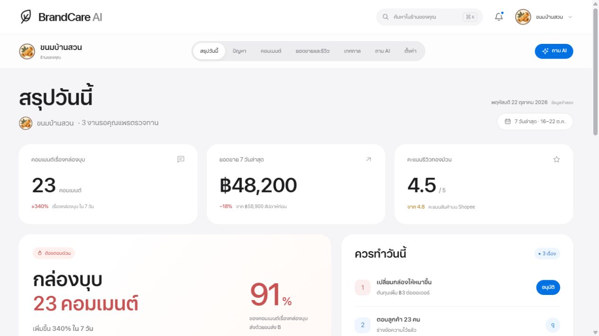

https://github.com/user-attachments/assets/15a1b77e-30c2-4577-a57a-6ab81e45fabd

*วิดีโอแนะนำ BrandCare AI · 1:45 นาที · กดเล่นพร้อมเสียง*

# BrandCare AI

ผู้ช่วย AI สำหรับเจ้าของร้านออนไลน์ ที่เชื่อมเสียงลูกค้าเข้ากับข้อมูลยอดขาย และช่วยจัดลำดับเรื่องที่ควรดูแลในแต่ละวัน

BrandCare AI ออกแบบสำหรับผู้ประกอบการไทยและร้านขนาดเล็กที่มีทีมจำกัด เจ้าของร้านมักต้องขายสินค้า ตอบลูกค้า ดูรีวิว และวางแผนการตลาดด้วยตัวเอง เราต้องการช่วยให้ข้อมูลที่มีอยู่แล้วกลายเป็นข้อสรุปและงานที่เจ้าของร้านตรวจสอบก่อนลงมือทำได้

## ปัญหาที่เราอยากแก้

เมื่อร้านขายผ่านหลายช่องทาง ความคิดเห็น คำถาม และรีวิวของลูกค้าจะกระจายอยู่คนละที่ เจ้าของร้านต้องอ่านและจับประเด็นเอง ขณะที่ข้อมูลยอดขายก็อยู่ในอีกหน้าจอหนึ่ง จึงอาจมองเห็นคำบ่นที่เกิดซ้ำช้า ไม่ทันตอบคนที่สนใจซื้อ หรือยังไม่รู้ว่าควรเริ่มแก้เรื่องใดก่อน

หลักฐานประกอบโจทย์นี้มีทั้งข้อมูลไทยและต่างประเทศ:

- **62.72%** ของ SMEs กลุ่มตัวอย่างไทยระบุปัญหาขาดทักษะและความสามารถด้านดิจิทัล — [ETDA, SME Digital Maturity Survey 2023](https://www.etda.or.th/th/Useful-Resource/etda_sme.aspx), 1,725 บริษัทในกลุ่ม High Value Sector และ S-curve
- **63%** ของผู้ค้าปลีกในผลสำรวจอีคอมเมิร์ซขายบนอย่างน้อย 3 แพลตฟอร์ม — [DHL 2025](https://group.dhl.com/en/media-relations/press-releases/2025/dhl-e-commerce-trends-report-2025-business-edition.html), สำรวจธุรกิจ 4,050 แห่ง ใน 19 ตลาด
- **53%** ของผู้นำ SMB ระบุว่าข้อมูลมักไม่สอดคล้องกันระหว่างเครื่องมือธุรกิจ — [Salesforce, 6th Edition หน้า 13](https://www.salesforce.com/en-us/wp-content/uploads/sites/4/documents/resources/smb-trends-report-6th-edition_Salesforce.pdf), 3,350 คนใน 26 ประเทศ เก็บข้อมูลปี 2024
- **89%** ของผู้บริโภคในผลสำรวจคาดหวังให้ธุรกิจตอบรีวิว — [BrightLocal 2026](https://www.brightlocal.com/research/local-consumer-review-survey/), ผู้ใหญ่สหรัฐฯ 1,002 คน สำรวจเกี่ยวกับธุรกิจท้องถิ่น

ตัวเลขแต่ละชุดใช้กลุ่มตัวอย่างต่างกัน ไม่ใช่อัตราของร้านออนไลน์ไทยทั้งหมด และยังไม่ใช่ผลลัพธ์จากการใช้ BrandCare AI อ่านขอบเขตและข้อจำกัดเพิ่มเติมใน [หลักฐานปัญหา](docs/research/problem-evidence.md)

## เราวางแผนช่วยอย่างไร

1. **รวบรวมเสียงลูกค้า** จาก marketplace และโซเชียลที่ร้านใช้งาน เพื่อให้ค้นและอ่านข้อมูลร่วมกันได้
2. **ทำความเข้าใจและจัดกลุ่ม** แยกคำร้องเรียน คำชม คำถาม และความสนใจซื้อ พร้อมรวบรวมประเด็นที่เกิดซ้ำ
3. **ดูร่วมกับยอดขายและรีวิว** เพื่อช่วยเจ้าของร้านตั้งคำถามและตรวจสอบหลักฐาน โดยไม่สรุปว่าความสัมพันธ์ของข้อมูลเป็นเหตุและผลเสมอไป
4. **จัดลำดับสิ่งที่ควรทำ** เช่น ตรวจบรรจุภัณฑ์ ดูแลลูกค้าที่ได้รับผลกระทบ หรือตอบคนที่ถามหาช่องทางซื้อ
5. **ช่วยร่างและวางแผน** ทั้งคำตอบลูกค้าและคอนเทนต์เทศกาล โดยให้เจ้าของร้านตรวจ แก้ไข และอนุมัติก่อนนำไปใช้

เจ้าของร้านยังเป็นผู้ตัดสินใจ ระบบต้องแสดงที่มาของข้อเสนอแนะและเปิดให้ตรวจสอบหลักฐานได้

## ตัวอย่างการใช้งาน

ในเดโม ร้านสมมติ **ขนมบ้านสวน** พบคอมเมนต์เรื่องกล่องบุบเพิ่มขึ้น ขณะยอดขายสินค้าบางรายการและคะแนนรีวิวลดลง เจ้าของร้านเปิดดูคอมเมนต์และข้อมูลที่เกี่ยวข้อง เปรียบเทียบสิ่งที่เกิดขึ้น แล้วตรวจข้อเสนอเรื่องบรรจุภัณฑ์และร่างคำตอบลูกค้า

เส้นทางหลัก: ตั้งค่าร้าน → เชื่อมข้อมูลตัวอย่าง → วิเคราะห์จำลอง → สรุปวันนี้ → ตรวจปัญหาและหลักฐาน → ตรวจร่างคำตอบและยืนยันในเดโม



## สิ่งที่ทดลองได้ในต้นแบบ

| ส่วนของผลิตภัณฑ์ | สิ่งที่แสดงในเดโม |
| --- | --- |
| สรุปวันนี้ | ตัวเลขสำคัญ ประเด็นที่ควรดูแล และงานที่รอตรวจทาน |
| ปัญหา | รายการปัญหา รายละเอียด หลักฐาน และ flow ตรวจร่างคำตอบ |
| คอมเมนต์ | ค้นหา กรองหมวดหมู่ และเปิดดูรายละเอียดเสียงลูกค้า |
| ยอดขายและรีวิว | เปรียบเทียบยอดขาย ดูสินค้า รีวิว และข้อมูลที่เกี่ยวข้อง |
| เทศกาล | ปฏิทินและแผนคอนเทนต์ที่ร้านแก้ไขก่อนนำไปใช้ |
| ถาม AI | บทสนทนาตัวอย่างและการแสดงคำตอบแบบทยอยพิมพ์ |
| ตั้งค่า | ข้อมูลร้าน การเชื่อมบัญชีตัวอย่าง และตัวเลือกแจ้งเตือน |

รองรับ Desktop และ Mobile โดยใช้ Header บนหน้าจอใหญ่และ Bottom navigation บนมือถือ

## สถานะปัจจุบัน

โปรเจกต์นี้เป็น **UI mockup สำหรับ Hackathon** พัฒนาด้วย HTML, CSS และ JavaScript โดยมี shared components และ hash-based routes ข้อมูลบางส่วนเก็บในเบราว์เซอร์

ร้าน ลูกค้า คอมเมนต์ ยอดขาย และผลวิเคราะห์ในเดโมเป็นข้อมูลสมมติทั้งหมด ปัจจุบันยังไม่มี backend, authentication/OAuth จริง, การเชื่อมข้อมูล marketplace, การเรียกโมเดล AI หรือการส่งข้อความและโพสต์จริง ปุ่มยืนยันและสถานะติดตามใช้สาธิต flow เท่านั้น

ขั้นถัดไปคือทดลองกับเจ้าของร้านจริง วัดเวลาที่ใช้ค้นพบปัญหา ความถูกต้องของการจัดกลุ่ม และการยอมรับร่างคำตอบ ก่อนประเมินผลต่อการทำงานหรือยอดขาย

## เปิดเดโมในเครื่อง

ต้องมี Python 3; หากใช้คำสั่ง npm ต้องมี Node.js ด้วย โปรเจกต์เว็บไม่มี dependencies ที่ต้องติดตั้ง

```powershell
npm run dev
```

หรือรัน `python -m http.server 4174 --bind 127.0.0.1` แล้วเปิด [BrandCare AI](http://localhost:4174/#/today) เริ่ม onboarding ได้ที่ [หน้า Login](http://localhost:4174/#/login)

## เอกสารทีม

- [คู่มือ Git สำหรับเพื่อนร่วมทีมและ AI](TEAM-GIT-WORKFLOW.md)
- [แผนหน้าและการแบ่งงาน](MOCKUP-PAGES.md)
- [สถานะงานและผลตรวจ](MOCKUP-TRACKING.md)
- [คู่มือคอมโพเนนต์กลาง](shared/README.md)
- [บริบทและหลักการผลิตภัณฑ์](PRODUCT.md)
- [หลักฐานปัญหาและแหล่งอ้างอิง](docs/research/problem-evidence.md)

- [เครดิตเพลงและรายละเอียดวิดีโอ](docs/video/MUSIC-CREDITS.md)
